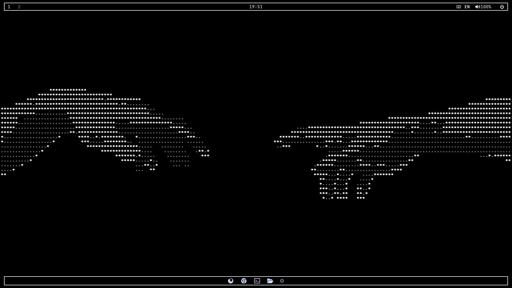
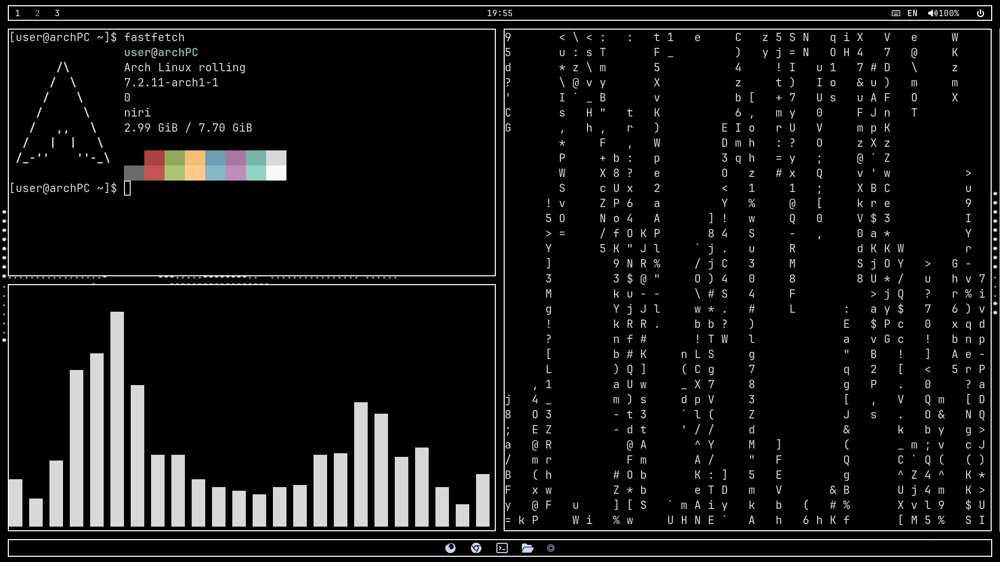
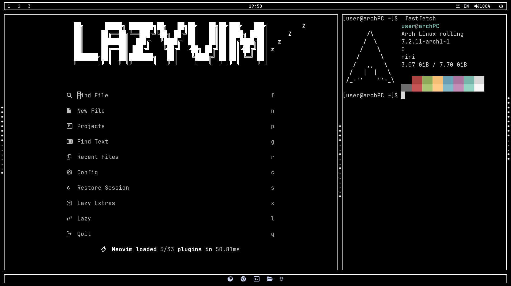
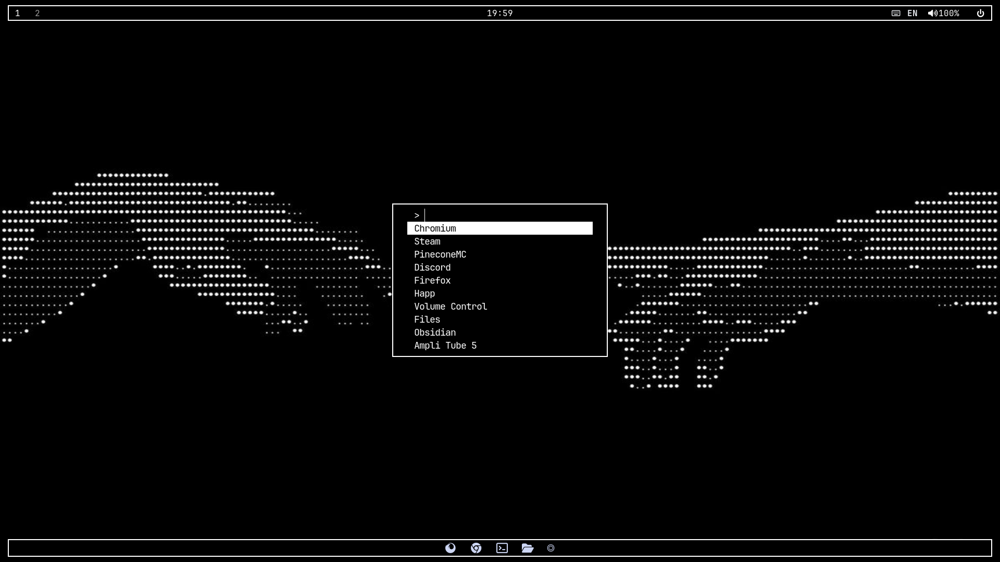

# Minimalistic Dark Rice
A minimal black and white rice for Niri :black_circle: :white_circle:

## Preview





## Components
- Niri — Window manager
- Waybar — Status bar
- Alacritty — Terminal emulator
- Fuzzel — Application launcher
- Mako — Notification daemon
- Neovim — Text editor
- Wlogout — Logout menu
- Swaybg — Wallpaper manager

## Installation

### Requirements
- Arch Linux
- Niri

#### 1. Install dependencies
```bash
sudo pacman -S --needed alacritty waybar fuzzel mako neovim wlogout swaybg
```

### 2. Clone the repository
```bash
git clone https://github.com/voidex011/minimalisticDarkRice.git

cd minimalisticDarkRice
```

### 3. Install configurations
```bash
cp -a config/. ~/.config/
```

### 4. Wallpapers
```bash
mkdir -p ~/Pictures/Wallpapers

cp wallpapers/wl.jpg ~/Pictures/Wallpapers/
```
## Attention!

> **Note**: This may overwrite existing configurations. Back up your current ~/.config files before installing.
